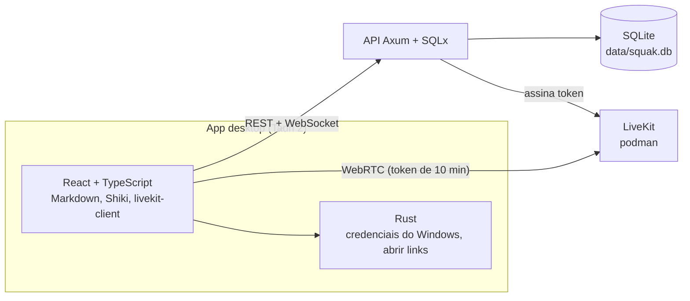
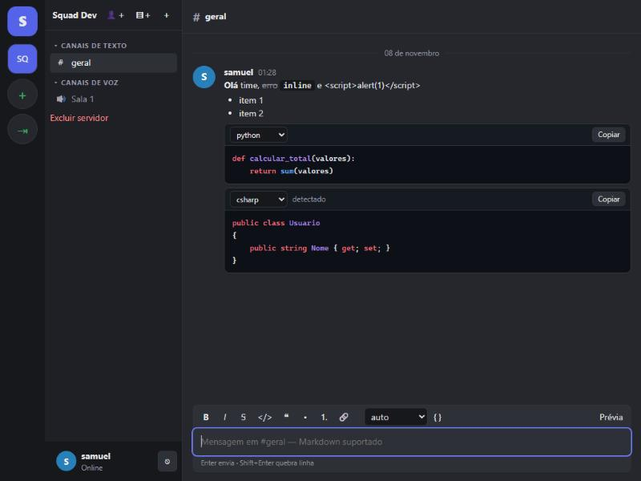
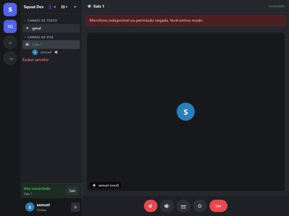

🇧🇷 Português | [🇺🇸 English](README_EN.md)

<div align="center">

# 💬 Squak

### _Comunicação desktop com servidores, chat em Markdown e salas de voz_

       

**Squak é um app desktop para Windows com servidores, canais de texto e voz, chat persistente com Markdown e código com destaque de sintaxe, e mídia em tempo real pelo LiveKit. O backend é um serviço Rust independente com SQLite.**

</div>

---

## 🌟 Principais Funcionalidades

### 1. 🔐 Autenticação e sessões
Cadastro, login e logout com sessões revogáveis.
- Senhas com **Argon2id**; do token de sessão só o hash **SHA-256** vai ao banco.
- Bloqueio de login após **5 falhas em 15 minutos** por usuário.
- No desktop, a sessão fica no **Gerenciador de Credenciais do Windows** (crate `keyring`), nunca em texto puro.

### 2. 🏠 Servidores, categorias e canais
- Criar, excluir e sair de servidores; convites de **10 caracteres com validade de 7 dias**, revogáveis.
- Cargos **dono / admin / membro**; admin cria canais e categorias, só o dono promove, e ninguém expulsa o dono.
- Canais **texto** e **voz**; a categoria precisa ser do mesmo servidor.

### 3. 💬 Chat em tempo real
- Mensagens persistidas em **SQLite**, com **paginação por cursor** (50 por página).
- Reenvio com o mesmo `client_nonce` não duplica a mensagem; a UI só marca como salva após a resposta da API.
- Responder, editar (só o autor), excluir (autor ou admin), reações, indicador de digitação, não lidas.
- **WebSocket** autenticado na primeira mensagem (token fora da URL), reconexão com **backoff exponencial** e evento `resync` após reconectar.

### 4. 📝 Markdown e código
- O banco guarda o **Markdown original**, nunca HTML. A renderização usa **react-markdown + remark-gfm**, sem interpretar HTML bruto.
- Blocos de código com **Shiki** (gramáticas carregadas sob demanda), botão copiar, numeração de linhas e troca manual de linguagem.
- Sem linguagem informada, uma heurística tenta identificar; sem confiança suficiente, mostra texto simples.

### 5. 🔊 Salas de voz
- A API só emite o token LiveKit para **membros do servidor**, com validade de **10 minutos**, restrito à sala `squak-<id do canal>`. O segredo do LiveKit nunca vai ao cliente.
- Microfone, câmera, silenciar áudio local, troca de dispositivos, volume por participante, quem está falando, reconexão.
- Quem está na sala aparece para os outros membros via WebSocket (`voice.member_joined`, `voice.member_left`, `voice.state_changed`).

### 6. 🖥️ Compartilhamento de tela
O módulo nativo do `COMPARTILHARTELAV2` foi portado para `apps/desktop/src-tauri/src` (`share.rs`, `sources.rs`, `media/`): captura **Windows Graphics Capture**, **H.264** pelo encoder do Windows e áudio **WASAPI** (sistema, por aplicativo ou sistema sem um aplicativo).
- O app entra na sala como segundo participante `<id>-share`. A API emite para ele um token que só publica `screen_share` e `screen_share_audio`, e só para quem já está na sala.
- O seletor mostra telas e janelas com miniatura, com qualidade 720p30, 1080p30 ou 1080p60 e modo "movimento" ou "texto".
- No navegador (dev) o botão cai para `getDisplayMedia`.
- A auditoria está em [docs/SCREEN_SHARE_INTEGRATION.md](docs/SCREEN_SHARE_INTEGRATION.md). **Compila e a API é testada, mas a transmissão em si ainda não foi testada de ponta a ponta.**

### 7. 🧭 Workspace de desenvolvimento (nova navegação)
Seletor de workspaces com busca e favoritos, barra lateral contextual, paleta de comandos (`Ctrl+K`), painel opcional de membros (`Ctrl+\`) e áreas próprias: **Início**, **Mensagens**, **Chamadas**, **Atividade**, **Pull requests**, **GitHub** e **Integrações**. A chamada continua ligada ao navegar. Auditoria e decisões em [docs/REDESIGN.md](docs/REDESIGN.md).

### 8. 🐙 Integração com GitHub
Conexão por **GitHub App + Device Flow** (independente do login do Squak), perfil de desenvolvedor, **calendário de contribuições** com as cores e níveis reais da API GraphQL, timeline de atividade, PRs com revisão e CI separados e feed da equipe alimentado por **webhooks assinados** e idempotentes. Tokens ficam cifrados (AES-256-GCM) no servidor e nunca chegam ao app.
**Sem credenciais da GitHub App a integração real fica pendente**: veja [docs/GITHUB_INTEGRATION.md](docs/GITHUB_INTEGRATION.md). Com `GITHUB_MOCK=1` o app usa dados simulados, sempre sinalizados na tela.

### 9. 🔌 Integrações extensíveis
Registro de provedores com contrato comum; o Jira está declarado como "planejado" (OAuth 2.0, projetos, issues, responsáveis, status e webhooks) em [docs/INTEGRATIONS.md](docs/INTEGRATIONS.md), sem chamadas reais ainda.

---

## 🏗️ Arquitetura



**Cliente → API (REST + WebSocket) → SQLite**, e **cliente → LiveKit** para áudio e vídeo com token assinado pela API.

---

## 📊 Resultados

Capturas reais da interface rodando contra a API e o LiveKit locais.

<div align="center">



<p><em>Markdown renderizado, bloco Python com linguagem explícita e bloco C# detectado automaticamente. O <code>&lt;script&gt;</code> digitado aparece como texto.</em></p>



<p><em>Sala de voz conectada ao LiveKit. O navegador do teste bloqueou o microfone, e o app avisou "Você entrou mudo" sem desconectar.</em></p>

</div>

| Verificação | Resultado |
|---|---|
| `cargo test -p squak-api` | 5 de 5 testes passam |
| `npm test` (detecção de linguagem) | 10 de 10 testes passam |
| `npm run build` | passa |
| `cargo check -p squak-desktop` | passa |
| Áudio e câmera entre dois clientes | **não testado** |
| `tauri dev` / instalador Windows | **não executado** |

---

## ⚡ Quickstart

Requisitos: **Rust** (testado com 1.99), **Node.js** (testado com 24), **podman** e o **WebView2** do Windows.

### 1. Configurar o ambiente
```powershell
Copy-Item .env.example .env
```
Edite o `.env` e troque `LIVEKIT_API_SECRET` por um valor longo e aleatório. O `.env` não é versionado.

### 2. Subir o LiveKit com podman
```powershell
podman machine start
powershell -File scripts\livekit-up.ps1
```
O script lê as chaves do `.env` e expõe as portas 7880, 7881 e 7882/udp. Não há provedor de compose instalado, por isso o script usa `podman run`.

### 3. Subir a API
```powershell
cargo run -p squak-api
```
Rode na raiz do repositório. O banco `data/squak.db` e suas tabelas são criados no primeiro start. A API escuta em `127.0.0.1:8080`.

### 4. Subir o app desktop
```powershell
cd apps\desktop
npm install
npm run dev
```
Abra `http://localhost:1420` para usar no navegador. Em dev, a sessão cai para `localStorage`.

Para a janela nativa do Tauri, em outro terminal na pasta `apps\desktop`:
```powershell
npx tauri dev
```
O primeiro build compila as dependências do Tauri e demora vários minutos. Esse comando ainda não foi executado.

### 5. Usar
1. Cadastre-se na tela inicial.
2. Crie um servidor (`＋`). Ele nasce com `#geral` e `Sala 1`.
3. Para convidar alguém, use `👤＋` e passe o código; a outra pessoa usa `⇥` e cola o código.

---

## 💻 Exemplos de Uso

Respostas reais da API (PowerShell; o `curl` do Git Bash do Windows quebra acentos em JSON):

```powershell
Invoke-RestMethod -Method Post http://127.0.0.1:8080/auth/register -ContentType 'application/json' `
  -Body '{"username":"ana","password":"senha-forte-123"}'
```
```json
{"token":"<token>","user":{"id":"2f66dbbb-8f83-4734-828d-f6cce9fc3d55","username":"ana"}}
```

```powershell
$h = @{ Authorization = "Bearer $token" }
Invoke-RestMethod -Method Post http://127.0.0.1:8080/servers -Headers $h -ContentType 'application/json' -Body '{"name":"Squad Dev"}'
```
```json
{"id":"31f0c242-fdb3-49fc-a843-becf5896bf6a","name":"Squad Dev","owner_id":"2f66dbbb-8f83-4734-828d-f6cce9fc3d55","role":"owner"}
```

Enviar mensagem (resposta abreviada):
```json
{"author":{"username":"ana"},"content":"**oi** time","created_at":1794112493528,"deleted":false,"reactions":[],"reply_to":null}
```

Rotas principais: `POST /auth/register`, `POST /auth/login`, `GET|POST /servers`, `GET /servers/{id}`, `POST /servers/{id}/invites`, `POST /invites/{code}/join`, `GET|POST /channels/{id}/messages?before=<id>&limit=50`, `POST /channels/{id}/voice-token`, `GET /ws`.

---

## 💻 Exemplo de Código

Emissão do token de voz (trecho de `services/api/src/voice.rs`, versão resumida):

```rust
let (sid, kind, _) = channel_info(&s, &cid).await?;
require_member(&s, &sid, &u.id).await?;           // só membros do servidor
if kind != "voice" { return Err(ApiError::BadRequest("não é um canal de voz".into())); }
// JWT HS256 de 10 minutos, com permissão apenas para a sala squak-<id do canal>
```

---

## 🧪 Testes Automatizados

```powershell
cargo test -p squak-api          # integração da API com SQLite em memória
cd apps\desktop; npm test        # detecção de linguagem (vitest)
```

Os testes da API cobrem autenticação e bloqueio por força bruta, isolamento de dados entre servidores, convites, cargos e canais, mensagens (CRUD, paginação, deduplicação, reações, Markdown guardado sem alteração) e o token de voz. **O WebSocket e o fluxo de mídia não têm teste automatizado.**

---

## 🗂️ Estrutura do Repositório

```text
services/api/        API Axum + SQLx (auth, servers, messages, realtime, voice)
  migrations/        esquema SQLite
  tests/             testes de integração
apps/desktop/        app Tauri 2 + React
  src/               interface (chat, voz, Markdown, WebSocket)
  src-tauri/         núcleo Rust (credenciais, abrir links)
scripts/             livekit-up.ps1 (LiveKit via podman)
docs/                SCREEN_SHARE_INTEGRATION.md
img/                 capturas usadas neste README
```

---

## 📚 Documentação

- [Auditoria do compartilhamento de tela](docs/SCREEN_SHARE_INTEGRATION.md)
- [`.env.example`](.env.example): variáveis de ambiente

---

## 🚧 Limitações e Próximos Passos

- Compartilhamento de tela **portado e compilando, mas não testado ao vivo** (captura, codificação e recepção).
- Áudio, câmera e tela **não validados** entre dois clientes Windows.
- O `.cargo/config.toml` usa `C:/pt-target` como pasta de build (o libwebrtc estoura o limite de 260 caracteres do Windows em caminhos longos).
- Anexos, notificações, menções, reordenação de canais e permissões por canal **não implementados**.
- Presença: a API informa online/offline por conexão; ausente e ocupado ainda não existem.
- Chamadas individuais e em grupo **não implementadas** (só salas de voz).
- O WebSocket valida a associação ao servidor a cada evento, mas **não tem teste automatizado**.
- A API libera CORS para qualquer origem (a autenticação é por Bearer, sem cookies). Revise antes de expor na rede.
- Medições de desempenho (memória, CPU, latência) **não feitas**.

