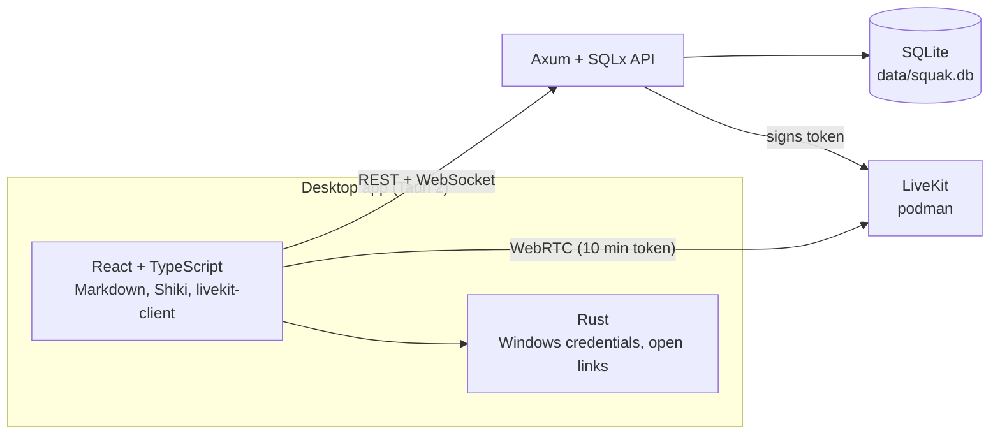
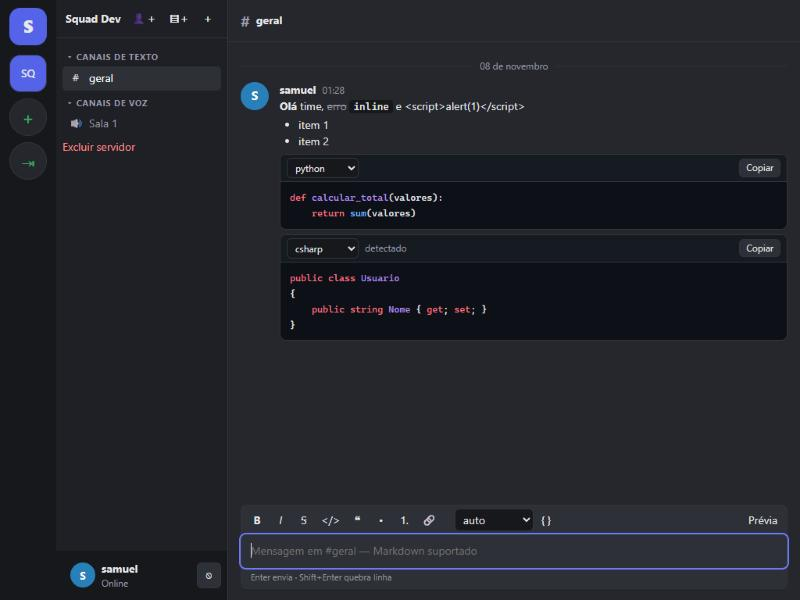
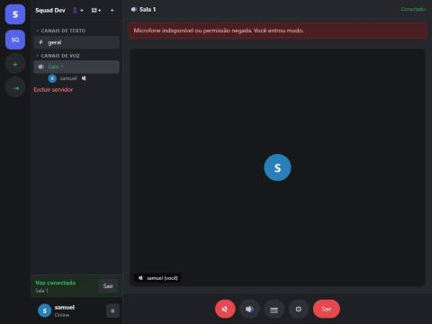

[🇧🇷 Português](README.md) | 🇺🇸 English

<div align="center">

# 💬 Squak

### _Desktop communication with servers, Markdown chat and voice rooms_

       

**Squak is a Windows desktop app with servers, text and voice channels, persistent chat with Markdown and syntax-highlighted code, and real-time media through LiveKit. The backend is a standalone Rust service backed by SQLite.**

</div>

---

## 🌟 Main Features

### 1. 🔐 Authentication and sessions
Sign up, log in and log out with revocable sessions.
- Passwords use **Argon2id**; only the **SHA-256** hash of the session token is stored.
- Login lockout after **5 failures in 15 minutes** per user.
- On desktop the session lives in the **Windows Credential Manager** (`keyring` crate), never in plain text.

### 2. 🏠 Servers, categories and channels
- Create, delete and leave servers; **10-character invites valid for 7 days**, revocable.
- **Owner / admin / member** roles; admins create channels and categories, only the owner promotes, nobody can kick the owner.
- **Text** and **voice** channels; a category must belong to the same server.

### 3. 💬 Real-time chat
- Messages persisted in **SQLite** with **cursor pagination** (50 per page).
- Resending with the same `client_nonce` does not duplicate the message; the UI marks it saved only after the API replies.
- Reply, edit (author only), delete (author or admin), reactions, typing indicator, unread badges.
- **WebSocket** authenticated in the first message (token kept out of the URL), reconnection with **exponential backoff** and a `resync` event after reconnecting.

### 4. 📝 Markdown and code
- The database stores the **original Markdown**, never HTML. Rendering uses **react-markdown + remark-gfm** and does not interpret raw HTML.
- Code blocks use **Shiki** (grammars loaded on demand), a copy button, line numbers and a manual language switch.
- With no language given, a heuristic tries to detect it; without enough confidence it shows plain text.

### 5. 🔊 Voice rooms
- The API issues the LiveKit token only to **server members**, valid for **10 minutes**, restricted to the room `squak-<channel id>`. The LiveKit secret never reaches the client.
- Microphone, camera, local mute, device switching, per-participant volume, active speaker, reconnection.
- Who is in a room is shown to other members over WebSocket (`voice.member_joined`, `voice.member_left`, `voice.state_changed`).

### 6. 🖥️ Screen sharing (integration pending)
The `COMPARTILHARTELAV2` project already has native Rust capture (Windows Graphics Capture, H.264 and WASAPI audio). The audit and integration plan are in [docs/SCREEN_SHARE_INTEGRATION.md](docs/SCREEN_SHARE_INTEGRATION.md) (Portuguese only). **Not ported yet.**

---

## 🏗️ Architecture



**Client → API (REST + WebSocket) → SQLite**, and **client → LiveKit** for audio and video with a token signed by the API.

---

## 📊 Results

Real screenshots of the interface running against the local API and LiveKit.

<div align="center">



<p><em>Rendered Markdown, a Python block with an explicit language and a C# block detected automatically. The typed <code>&lt;script&gt;</code> shows as text.</em></p>



<p><em>Voice room connected to LiveKit. The test browser blocked the microphone, and the app showed "you joined muted" without disconnecting.</em></p>

</div>

| Check | Result |
|---|---|
| `cargo test -p squak-api` | 5 of 5 tests pass |
| `npm test` (language detection) | 10 of 10 tests pass |
| `npm run build` | passes |
| `cargo check -p squak-desktop` | passes |
| Audio and camera between two clients | **not tested** |
| `tauri dev` / Windows installer | **not run** |

---

## ⚡ Quickstart

Requirements: **Rust** (tested with 1.99), **Node.js** (tested with 24), **podman** and the Windows **WebView2**.

### 1. Configure the environment
```powershell
Copy-Item .env.example .env
```
Edit `.env` and replace `LIVEKIT_API_SECRET` with a long random value. `.env` is not versioned.

### 2. Start LiveKit with podman
```powershell
podman machine start
powershell -File scripts\livekit-up.ps1
```
The script reads the keys from `.env` and exposes ports 7880, 7881 and 7882/udp. No compose provider is installed, so the script uses `podman run`.

### 3. Start the API
```powershell
cargo run -p squak-api
```
Run it from the repository root. `data/squak.db` and its tables are created on first start. The API listens on `127.0.0.1:8080`.

### 4. Start the desktop app
```powershell
cd apps\desktop
npm install
npm run dev
```
Open `http://localhost:1420` to use it in the browser. In dev the session falls back to `localStorage`.

For the native Tauri window, in another terminal inside `apps\desktop`:
```powershell
npx tauri dev
```
The first build compiles the Tauri dependencies and takes several minutes. This command has not been run yet.

### 5. Use it
1. Sign up on the first screen.
2. Create a server (`＋`). It starts with `#geral` and `Sala 1`.
3. To invite someone, use `👤＋` and share the code; the other person uses `⇥` and pastes it.

---

## 💻 Usage Examples

Real API responses (PowerShell; the Windows Git Bash `curl` breaks accents in JSON):

```powershell
Invoke-RestMethod -Method Post http://127.0.0.1:8080/auth/register -ContentType 'application/json' `
  -Body '{"username":"ana","password":"senha-forte-123"}'
```
```json
{"token":"<token>","user":{"id":"2f66dbbb-8f83-4734-828d-f6cce9fc3d55","username":"ana"}}
```

```powershell
$h = @{ Authorization = "Bearer $token" }
Invoke-RestMethod -Method Post http://127.0.0.1:8080/servers -Headers $h -ContentType 'application/json' -Body '{"name":"Squad Dev"}'
```
```json
{"id":"31f0c242-fdb3-49fc-a843-becf5896bf6a","name":"Squad Dev","owner_id":"2f66dbbb-8f83-4734-828d-f6cce9fc3d55","role":"owner"}
```

Send a message (abridged response):
```json
{"author":{"username":"ana"},"content":"**oi** time","created_at":1794112493528,"deleted":false,"reactions":[],"reply_to":null}
```

Main routes: `POST /auth/register`, `POST /auth/login`, `GET|POST /servers`, `GET /servers/{id}`, `POST /servers/{id}/invites`, `POST /invites/{code}/join`, `GET|POST /channels/{id}/messages?before=<id>&limit=50`, `POST /channels/{id}/voice-token`, `GET /ws`.

---

## 💻 Code Example

Voice token issuance (excerpt from `services/api/src/voice.rs`, abridged):

```rust
let (sid, kind, _) = channel_info(&s, &cid).await?;
require_member(&s, &sid, &u.id).await?;           // server members only
if kind != "voice" { return Err(ApiError::BadRequest("não é um canal de voz".into())); }
// 10-minute HS256 JWT, granting access only to the room squak-<channel id>
```

---

## 🧪 Automated Tests

```powershell
cargo test -p squak-api          # API integration tests on in-memory SQLite
cd apps\desktop; npm test        # language detection (vitest)
```

The API tests cover authentication and brute-force lockout, data isolation between servers, invites, roles and channels, messages (CRUD, pagination, deduplication, reactions, Markdown stored unchanged) and the voice token. **The WebSocket and the media flow have no automated tests.**

---

## 🗂️ Repository Structure

```text
services/api/        Axum + SQLx API (auth, servers, messages, realtime, voice)
  migrations/        SQLite schema
  tests/             integration tests
apps/desktop/        Tauri 2 + React app
  src/               UI (chat, voice, Markdown, WebSocket)
  src-tauri/         Rust core (credentials, open links)
scripts/             livekit-up.ps1 (LiveKit via podman)
docs/                SCREEN_SHARE_INTEGRATION.md
img/                 screenshots used in this README
```

---

## 📚 Documentation

- [Screen sharing audit](docs/SCREEN_SHARE_INTEGRATION.md) (Portuguese only)
- [`.env.example`](.env.example): environment variables

---

## 🚧 Limitations and Next Steps

- Screen sharing **not ported** from the existing project.
- Audio, camera and screen **not validated** between two Windows clients.
- Attachments, notifications, mentions, channel reordering and per-channel permissions **not implemented**.
- Presence: the API reports online/offline per connection; away and busy do not exist yet.
- One-to-one and group calls **not implemented** (voice rooms only).
- The WebSocket checks server membership on every event but **has no automated test**.
- The API allows CORS from any origin (auth is Bearer-only, no cookies). Review before exposing it on a network.
- Performance measurements (memory, CPU, latency) **not done**.

---

**Samuel**

Technical portfolio and study project, focused on real-time communication architecture with Rust, Tauri and LiveKit. The screen capture module comes from the author's PartilharTela project.

[🇧🇷 Português](README.md) | 🇺🇸 English
