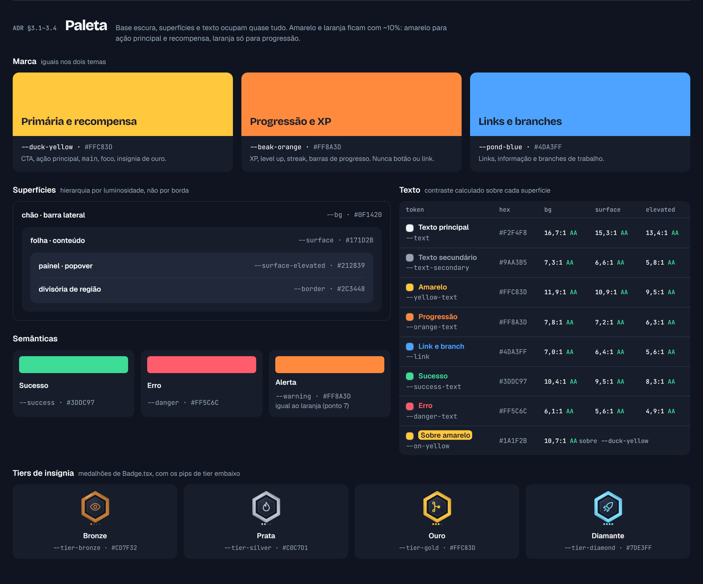
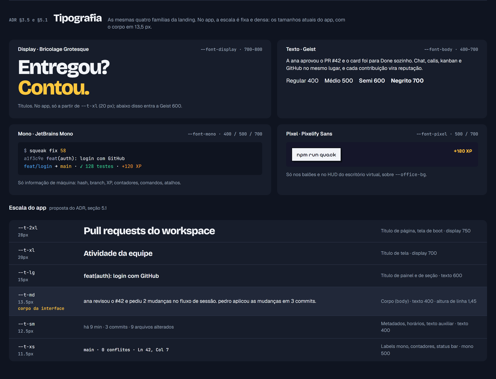
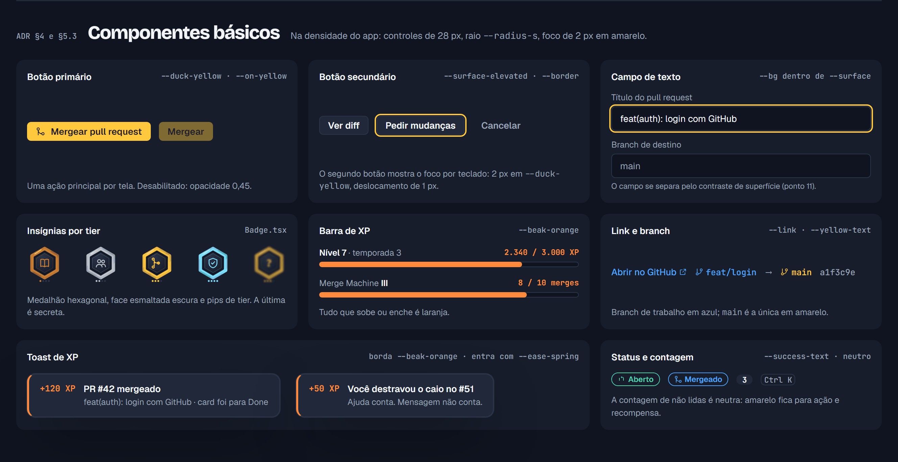
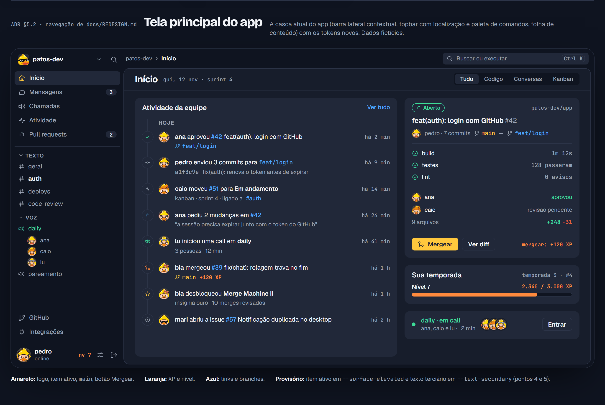
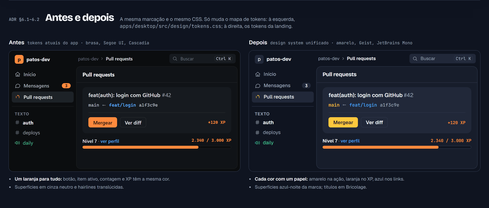

# ADR 002 — Design system unificado do Squeak

| | |
|---|---|
| **Status** | Proposto |
| **Data** | 2026-11-12 |
| **Autores** | Pedro, Samuel |
| **Fecha** | issue #3 |
| **Depende de** | issue #7 (reorganização do repositório), para o pacote `packages/design-tokens` |

## Sumário

- **Decisão:** o design system do produto inteiro (app desktop e landing) passa a ser o da landing page (`landing-page/src/styles/tokens.css`).
- **Tema do app:** por enquanto o app desktop usa **só o tema escuro**. O tema claro existe na landing e fica **planejado** para o app, sem data.
- **O que muda no app:**
  - o acento laranja "brasa" dá lugar ao amarelo do pato;
  - Segoe UI e Cascadia saem, e entram Bricolage Grotesque, Geist e JetBrains Mono;
  - as superfícies passam para o azul-noite da marca.
- **O que fica do app:**
  - a hierarquia por superfícies em vez de bordas;
  - a grade de 4 px;
  - a escala tipográfica fixa e densa (corpo de 13,5 px);
  - as medidas de layout, os ícones e os componentes de estado.
- **Próximo passo:** aplicar na Sprint 1, na issue "Aplicar o design system unificado no app". Hoje a fonte única é o `tokens.css` da landing. Depois da issue #7, ela vira `packages/design-tokens`.
- **Pontos em aberto:** 16 itens para a revisão do Samuel, na seção 7. Os principais são a troca de Segoe UI por Geist no Windows, a status bar amarela e os tokens de hover e pressionado.

**Fontes desta especificação:**

| Arquivo | Uso neste ADR |
|---|---|
| `landing-page/src/styles/tokens.css` | Valores de todos os tokens |
| `landing-page/docs/brand.md` | Regras de uso |
| `landing-page/docs/alinhamento.md` | Decisões pendentes |
| `apps/desktop/src/design/tokens.css` e `docs/REDESIGN.md` | Sistema atual do app, só para comparar e migrar |

Valores que não existem nesses arquivos não foram inventados: eles aparecem como **aberto**.

---

## Prévia visual

**Para abrir localmente:** [`docs/decisoes/002-design-system-preview.html`](002-design-system-preview.html). Abra direto no navegador, sem build. As fontes vêm do Google Fonts, então é preciso internet.

Como a prévia foi montada:

- Ela importa por caminho relativo `landing-page/src/styles/tokens.css` e `apps/desktop/src/design/tokens.css`. Do arquivo do app, usa só a escala `--t-*`, a grade `--sp-*`, as medidas de layout e os tokens antigos do "antes".
- O HTML não tem nenhum valor de cor, fonte ou espaço escrito à mão. Os hex e as razões de contraste exibidos são lidos do CSS quando a página abre.
- Ela mostra só o tema escuro.

As capturas abaixo foram feitas em Chrome headless a 2×.

### Paleta

Marca, superfícies, texto com contraste calculado sobre cada superfície, semânticas e tiers de insígnia.



### Tipografia

As quatro famílias com exemplos reais e a escala fixa do app (seção 5.1), com o corpo em 13,5 px.



### Componentes básicos

Botão primário e secundário (com o foco por teclado), campo de texto, insígnias por tier, barra de XP, link e branch, toast de XP, status e contagem.



### Tela principal do app

A casca atual do app (`Shell.tsx` e `REDESIGN.md`) com os tokens novos:

- barra lateral com a navegação, os canais de texto e voz, e o usuário com o nível;
- topbar com a localização e a paleta de comandos;
- feed de atividade e card de PR na área de conteúdo.

Os dados são fictícios.



### Antes e depois

A mesma marcação e o mesmo CSS, mudando só o mapa de tokens.

- À esquerda, os tokens atuais do app: laranja em tudo, cinza neutro e Segoe UI.
- À direita, o design system unificado.
- O "antes" usa Segoe UI Variable Text também nos títulos, porque nesta página o `--font-display` do app é sobrescrito pelo da landing.



**O que a prévia assume provisoriamente:**

| Elemento | Token usado | Ponto em aberto |
|---|---|---|
| Item ativo da barra lateral | `--surface-elevated` | 4 |
| Texto terciário | `--text-secondary` | 5 |
| Contagem de não lidas | Neutra, sem amarelo | — |
| Status bar | Não aparece | 3 |

---

## 1. Contexto

**Hoje existem dois design systems que não conversam.** O app desktop e a landing nasceram em momentos diferentes e tomaram decisões opostas em quase todos os eixos.

| Eixo | App desktop (`apps/desktop/src/design/tokens.css`) | Landing (`landing-page/src/styles/tokens.css`) |
|---|---|---|
| Acento | Laranja "brasa" `#ff8a3d`, único | Amarelo do pato `#FFC83D` (primária). O laranja `#FF8A3D` é só progressão. |
| Fundo e superfícies | Cinza neutro quase preto, de `#0b0d0f` a `#262c33` (5 níveis) | Azul-noite, de `#0F1420` a `#212839` (3 níveis), com borda `#2C3448` |
| Bordas | Hairlines translúcidas, `rgba(255,255,255,.07/.13)` | Borda sólida `--border` |
| Texto, display | Segoe UI Variable Display | Bricolage Grotesque |
| Texto, corpo | Segoe UI Variable Text | Geist |
| Mono | Cascadia Code | JetBrains Mono |
| Escala tipográfica | Fixa: 11,5 / 12,5 / 13,5 / 15 / 20 / 28 px | Fluida com `clamp()`, de `--step--1` a `--step-5` (até 10 rem) |
| Raios | 4 / 6 / 10 px e pílula | 6 / 12 / 20 px |
| Movimento | `cubic-bezier(.2,.7,.2,1)`, 110 e 180 ms | `cubic-bezier(0.22,1,0.36,1)` e mola, 160 e 320 ms |
| Temas | Só escuro | Escuro (padrão) e claro |
| Mascote e marca | Não aparecem | Squeak, logo, avatares, paleta pixel, tiers de insígnia |
| Nome nos comentários do código | "Squak" | "Squeak" |

**O problema de manter os dois:**

1. **A marca se quebra na passagem.** Quem chega pela landing (amarelo, pato, Bricolage) abre um app laranja em Segoe UI e não reconhece o produto.
2. **A mesma cor diz coisas diferentes.** No app, o laranja é ação primária (botão, foco, seleção). Na landing, o laranja é só progressão, como XP e level up. Quando a reputação chegar ao app, um botão laranja e uma barra de XP laranja vão competir.
3. **Trabalho em dobro.** Toda decisão de cor, contraste ou estado precisa ser tomada, documentada e testada duas vezes.
4. **O app não tem as peças de marca que o produto vai precisar.** Faltam tiers de insígnia, cores do mascote, avatares e paleta pixel do escritório virtual, e tudo isso já existe na landing.

---

## 2. Decisão

1. **O design system do produto inteiro, app desktop e landing, passa a ser o que está hoje na landing page.**
   - Tokens, regras de uso, tipografia e mascote seguem `landing-page/src/styles/tokens.css` e `landing-page/docs/brand.md`.
   - O sistema atual do app é substituído. Dele ficam só as ideias que não conflitam com esta decisão (seção 5.4).
2. **Por enquanto, o app desktop terá somente o MODO ESCURO dessa paleta.**
   - O tema escuro da landing (seção 3.2) é o tema oficial do app.
   - O tema claro continua na landing e fica documentado como **planejado para o app, sem data** (seção 3.3).
   - O app não implementa troca de tema nesta etapa.

Até existir `packages/design-tokens` (issue #7), **a fonte de verdade é `landing-page/src/styles/tokens.css`**. O app copia os tokens dali e não cria cor própria.

---

## 3. Especificação do design system

Todos os valores abaixo vêm de `landing-page/src/styles/tokens.css`. As razões de contraste foram **calculadas** a partir dos hex, pela fórmula de luminância relativa da WCAG 2.

### 3.1 Cores de marca

As cores de marca são iguais nos dois temas.

| Token | Valor | Papel |
|---|---|---|
| `--duck-yellow` | `#FFC83D` | **Primária e recompensa.** CTA, ação principal, `main` no grafo do git, status bar e insígnia de ouro. |
| `--beak-orange` | `#FF8A3D` | **Progressão e XP.** Tudo que sobe, enche ou evolui: XP, level up, streak, barras de progresso. |
| `--pond-blue` | `#4DA3FF` | **Links, informação e branches.** No grafo, branch é azul e `main` é amarela. |

### 3.2 Tema escuro (oficial do app)

O seletor na landing é `:root, [data-theme='dark']`, com `color-scheme: dark`.

**Superfícies e texto**

| Token | Valor | Papel | Contraste sobre `--bg` |
|---|---|---|---|
| `--bg` | `#0F1420` | Fundo base (o "chão") | — |
| `--surface` | `#171D2B` | Superfície: cartões, painéis, a "folha" | — |
| `--surface-elevated` | `#212839` | Superfície elevada: popovers e janelas sobre a superfície | — |
| `--border` | `#2C3448` | Borda e divisória | 1,5:1 (ver ponto 11) |
| `--text` | `#F2F4F8` | Texto principal | 16,7:1 |
| `--text-secondary` | `#9AA3B5` | Texto secundário e metadados | 7,3:1 |

**Texto e ícone em cor de marca.** No escuro, a cor pura passa AA.

| Token | Valor | Papel | Contraste sobre `--bg` / `--surface-elevated` |
|---|---|---|---|
| `--yellow-text` | `#FFC83D` | Texto e ícone amarelo | 11,9:1 / 9,5:1 |
| `--orange-text` | `#FF8A3D` | Texto de progressão (XP) | 7,8:1 / 6,3:1 |
| `--link` | `#4DA3FF` | Links e branches | 7,0:1 / 5,6:1 |
| `--success-text` | `#3DDC97` | Texto de sucesso | 10,4:1 / 8,3:1 |
| `--danger-text` | `#FF5C6C` | Texto de erro | 6,1:1 / 4,9:1 |
| `--on-yellow` | `#1A1F2B` | Texto sobre botão ou faixa amarela | 10,7:1 sobre `#FFC83D` |
| `--hl` | `#FFC83D` | Destaque em texto corrido | 11,9:1 |

**Atmosfera, código e insígnias**

| Token | Valor | Papel |
|---|---|---|
| `--glow-yellow` | `rgba(255, 200, 61, 0.18)` | Brilho de recompensa, por exemplo no hover do CTA |
| `--shadow-window` | `0 30px 80px -20px rgba(0,0,0,0.65), 0 0 0 1px var(--border)` | Sombra de janela, nos mockups da landing |
| `--grain-opacity` | `0.05` | Grão sutil sobre o fundo |
| `--code-comment` | `#8B95AD` | Sintaxe: comentário (6,1:1 sobre `--bg`) |
| `--code-keyword` | `#C792FF` | Sintaxe: palavra-chave |
| `--code-string` | `#3DDC97` | Sintaxe: string |
| `--badge-face` | `#121826` | Face esmaltada da insígnia |
| `--badge-face-hi` | `#2A3348` | Brilho da face da insígnia |
| `--office-bg` | `#15162A` | Fundo da cena do escritório virtual |

### 3.3 Tema claro — somente landing por enquanto; planejado para o app

O seletor é `[data-theme='light']`, com `color-scheme: light`. O app **não** implementa este tema agora. A tabela registra os valores para quando ele entrar.

| Token | Valor | Observação |
|---|---|---|
| `--bg` | `#FAF8F2` | |
| `--surface` | `#FFFFFF` | |
| `--surface-elevated` | `#FFFFFF` | Igual a `--surface`. O claro não tem um terceiro nível. |
| `--border` | `#E4DFD0` | Derivado: não estava no briefing original |
| `--text` | `#1A1F2B` | |
| `--text-secondary` | `#545C6E` | Derivado, 6,4:1 sobre `--bg` |
| `--yellow-text` | `#C99400` | Só para ícone e texto **grande** (3:1) |
| `--hl` | `#8A6400` | Amarelo para texto **pequeno**, AA 5,1:1 sobre `--bg` |
| `--orange-text` | `#B8530F` | |
| `--link` | `#1F6FD1` | |
| `--success-text` | `#138A5A` | |
| `--danger-text` | `#D0283A` | |
| `--on-yellow` | `#1A1F2B` | |
| `--office-bg` | `#15162A` | A cena do escritório continua escura |
| `--duck-outline` | `#3D2A00` | O mascote ganha contorno marrom |
| `--duck-highlight` / `--duck-shadow` | `#FFE08A` / `#E6A817` | |
| `--grain-opacity` | `0.035` | |
| `--glow-yellow` | `rgba(255, 200, 61, 0.28)` | |
| `--shadow-window` | `0 30px 70px -28px rgba(61,42,0,0.28), 0 0 0 1px var(--border)` | |
| `--code-comment` / `--code-keyword` / `--code-string` | `#6B7080` / `#7A3FD1` / `#138A5A` | |
| `--badge-face` / `--badge-face-hi` | `#1F2535` / `#3A4560` | A face da insígnia continua escura |
| `--sq-ink`, `--sq-rim`, `--sq-w0…w4`, `--sq-shadow`, `--sq-wet` | ver `tokens.css`, linhas 211–219 | Contorno marrom e água clara no pato pixel |

`--hl` e os tokens derivados ainda estão como decisão pendente em `alinhamento.md`, itens 3.4 e 3.5.

### 3.4 Cores semânticas e tiers de insígnia

As semânticas e os tiers são iguais nos dois temas. No claro, o texto usa as versões `*-text`.

| Token | Valor | Papel |
|---|---|---|
| `--success` | `#3DDC97` | Sucesso: check verde, merge, conectado |
| `--danger` | `#FF5C6C` | Erro, falha, ação destrutiva |
| `--warning` | `#FF8A3D` | Alerta. **Mesmo valor de `--beak-orange`** (ver ponto 7). |
| `--tier-bronze` | `#CD7F32` | Insígnia bronze |
| `--tier-silver` | `#C0C7D1` | Insígnia prata |
| `--tier-gold` | `#FFC83D` | Insígnia ouro (é o amarelo da marca) |
| `--tier-diamond` | `#7DE3FF` | Insígnia diamante |

As insígnias são medalhões hexagonais em SVG (`Badge.tsx`):

- anel no tom do tier, face `--badge-face` e glifo em traço de 1,7 px;
- quatro "pips" de tier embaixo;
- a insígnia secreta é o mesmo medalhão desfocado, com `?`.

### 3.5 Tipografia

**Famílias**

| Token | Pilha | Papel |
|---|---|---|
| `--font-display` | `'Bricolage Grotesque', 'Geist', system-ui, sans-serif` | **Display**: títulos. Na landing usa peso 750–800 e `opsz` 96. |
| `--font-body` | `'Geist', system-ui, -apple-system, 'Segoe UI', sans-serif` | **Texto**: corpo, interface, botões |
| `--font-mono` | `'JetBrains Mono', ui-monospace, 'Cascadia Code', Consolas, monospace` | **Mono**, a "voz de máquina": hash, branch, XP, contadores, comandos, código, status bar |
| `--font-pixel` | `'Pixelify Sans', 'JetBrains Mono', monospace` | **Pixel**: só nos balões e no HUD do escritório virtual |

Pesos carregados na landing:

| Família | Pesos |
|---|---|
| Bricolage Grotesque | 400–800, com `opsz` de 12 a 96 |
| Geist | 400–700 |
| JetBrains Mono | 400, 500 e 700 |
| Pixelify Sans | 500 e 700 |

**Escala da landing.** É fluida: o valor mínimo vale a 360 px de largura e o máximo a 1440 px. Ela **não vai para o app** (seção 5.1).

| Token | Valor | Papel |
|---|---|---|
| `--step--1` | `clamp(0.78rem, 0.76rem + 0.1vw, 0.84rem)` | Labels mono |
| `--step-0` | `clamp(1rem, 0.96rem + 0.18vw, 1.125rem)` | Corpo |
| `--step-1` | `clamp(1.2rem, 1.1rem + 0.45vw, 1.5rem)` | Lead |
| `--step-2` | `clamp(1.6rem, 1.3rem + 1.3vw, 2.5rem)` | h3 |
| `--step-3` | `clamp(2.2rem, 1.6rem + 2.8vw, 4.25rem)` | h2 |
| `--step-4` | `clamp(3rem, 1.9rem + 5.2vw, 7.5rem)` | Hero |
| `--step-5` | `clamp(3.4rem, 1.6rem + 8.4vw, 10rem)` | Fechamento |

**Regras de tipografia**

- Títulos usam tracking negativo, de `-0.032em` a `-0.038em`.
- O nome se escreve como componente, `<squeak/>`:
  - `squeak` em Bricolage 800;
  - `<` e `/>` em JetBrains Mono 400–500, na cor `--yellow-text`.
- Em texto corrido e em comandos, o nome fica minúsculo e sem tag (`squeak init`).

### 3.6 Espaçamento, raios e layout

| Token | Valor | Papel |
|---|---|---|
| `--radius-s` | `6px` | Controles: botões, inputs, chips |
| `--radius-m` | `12px` | Cartões e painéis |
| `--radius-l` | `20px` | Blocos grandes e janelas |
| `--statusbar-h` | `28px` | Altura da status bar |
| `--page-max` | `1440px` | Só na landing: largura máxima da página |
| `--spine-x` | `22px` (≥ 900 px de largura: `44px`) | Só na landing: posição da linha do git |
| `--gutter` | `52px` (≥ 900 px de largura: `112px`) | Só na landing: início da coluna de conteúdo |
| `--edge` | `16px` (≥ 900 px de largura: `clamp(24px, 5vw, 80px)`) | Só na landing: margem direita |

**Espaçamento:** a landing **não define escala de espaçamento em tokens**. Cada seção usa valores próprios. O app adota a grade de 4 px que já tem (seção 5.4).

### 3.7 Movimento

| Token | Valor | Uso |
|---|---|---|
| `--ease-out` | `cubic-bezier(0.22, 1, 0.36, 1)` | Easing padrão de tudo |
| `--ease-spring` | `cubic-bezier(0.34, 1.56, 0.64, 1)` | **Só recompensa**: insígnia, toast de XP, XP |
| `--dur-fast` | `160ms` | Hover, foco, troca de estado |
| `--dur-med` | `320ms` | Entradas e trocas de tema |

**Regra de `prefers-reduced-motion`.** Esta é a regra da landing (`global.css`) e vale para o app:

```css
@media (prefers-reduced-motion: reduce) {
  *, ::before, ::after {
    animation-duration: 0.001ms !important;
    animation-iteration-count: 1 !important;
    transition-duration: 0.001ms !important;
    scroll-behavior: auto !important;
  }
}
```

- Com movimento reduzido, cada tela mostra o **estado final** da animação, nunca um estado intermediário ou vazio.
- O mascote fica num quadro parado. Um clique mostra o quadro-chave da reação por 1,4 s.

### 3.8 Mascote

O Squeak é o pato de borracha do time.

**Cores**

| Token | Valor | Papel |
|---|---|---|
| `--duck-body` | `#FFC83D` | Corpo |
| `--duck-beak` | `#FF8A3D` | Bico |
| `--duck-eye` | `#1A1F2B` | Olho |
| `--catchlight` | `#FFFFFF` | Ponto de brilho do olho |
| `--duck-outline` (escuro) | `transparent` | Sem contorno no tema escuro |
| `--duck-highlight` (escuro) | `#FFE08A` | Brilho quente |
| `--duck-shadow` (escuro) | `#D99A1A` | Sombra quente |

**Regras de uso no tema escuro**

- **Sem contorno.** O pato se separa do fundo pelo brilho e pela sombra quentes.
- **Logo** (a cabeça do Squeak com óculos thug life, em `public/brand/`):
  - fundo transparente sobre `--bg` e `--surface`, sem borda, porque a arte já tem contorno laranja;
  - respiro mínimo de 1/4 da largura em volta.
- **Pixel art:**
  - sempre em escala inteira, para os pixels ficarem nítidos;
  - o renderizador usa só as rampas `--sq-*`: amarelo `y0–y5`, laranja `o0–o3`, metal `m0–m4`, água `w0–w4`, mais `ink`, `mouth`, `tongue`, `glow`, `rim`, `shadow` e `wet`.
- **Fotos de perfil:** um pato por pessoa (`Avatar.tsx`, `public/avatars/`), geradas por `tools/avatars.py`. São decorativas: o nome aparece sempre ao lado.
- **Nenhuma imagem do mascote vem de IA generativa.**

### 3.9 Paleta pixel art do escritório virtual

A paleta existe e fica em `landing-page/src/styles/tokens.css`, nos tokens com prefixo `--px-*`:

- tem 34 cores, de `--px-ink` a `--px-pot`;
- é derivada da marca;
- a cena é **sempre escura nos dois temas**, porque funciona como uma "tela de jogo";
- a resolução interna é 384×216, escalada por fator inteiro;
- a fonte dos balões é `--font-pixel`.

As regras completas estão em `brand.md`, seção 8.

---

## 4. Regras de uso

Estas regras vêm de `brand.md` e valem para o app e para a landing.

| # | Regra | Na prática |
|---|---|---|
| 1 | **60-30-10** | Cerca de 60% de base escura (`--bg`), 30% de superfícies e texto, e 10% de amarelo e laranja. |
| 2 | **Amarelo nunca como fundo de seção** | O amarelo é recompensa e ação principal: botão primário, foco, `main`, insígnia de ouro. Não serve de fundo de painel, barra lateral ou cabeçalho. A única exceção deliberada da landing é a status bar, com 28 px (ponto 3). |
| 3 | **Laranja sempre progressão** | Se algo sobe, enche ou evolui, é laranja: XP, level up, streak, barra de progresso. Laranja não é botão, foco nem link. |
| 4 | **Azul para branch e link** | Links, nomes de branch e informação são azuis. Assim o amarelo fica exclusivo de `main` e da recompensa. |
| 5 | **Mono só para informação de máquina** | Hash, branch, XP, contadores, comandos, atalhos e código. Não usar mono como decoração nem em texto corrido. |
| 6 | **Contraste mínimo WCAG AA** | Texto normal precisa de 4,5:1, texto grande e ícones de 3:1. No escuro, todas as cores de texto da seção 3.2 passam sobre `--bg`, `--surface` e `--surface-elevated`. No claro, nunca usar amarelo puro como texto: usar `--hl` em texto pequeno e `--yellow-text` só em texto grande. |
| 7 | **Nenhuma cor solta** | Todo componente usa token. Uma cor nova nasce primeiro no arquivo de tokens. |

---

## 5. Adaptações para o app desktop

**A landing é uma página de marketing e o app é uma ferramenta.** Ficam iguais as famílias tipográficas, todos os tokens de cor, as regras da seção 4 e o movimento. Mudam a escala tipográfica (fixa e densa), o espaçamento (grade de 4 px) e o layout.

### 5.1 Escala tipográfica fixa (proposta)

A escala fluida (`--step-*`, até 10 rem) e os títulos gigantes **não entram no app**. A proposta mantém os **tamanhos que o app já usa**, que estão em `apps/desktop/src/design/tokens.css` e são testados em densidade de ferramenta. As famílias passam a ser as da landing.

| Token | Tamanho | Família e peso propostos | Uso |
|---|---|---|---|
| `--t-xs` | 11,5 px | `--font-mono` 500 ou `--font-body` 400 | Labels mono, contadores, status bar (a da landing já usa `500 11.5px` mono) |
| `--t-sm` | 12,5 px | `--font-body` 400 | Metadados, horários, texto auxiliar |
| `--t-md` | **13,5 px** | `--font-body` 400, `line-height` 1,45 | **Corpo da interface** (`body`) |
| `--t-lg` | 15 px | `--font-body` 600 | Título de painel e de seção |
| `--t-xl` | 20 px | `--font-display` 700 | Título de tela |
| `--t-2xl` | 28 px | `--font-display` 750 | Título de página e tela de boot |

- O corpo fica entre 13 e 14 px, como pedido. O `line-height` de 1,45 é o atual do app.
- No app, o display (Bricolage) aparece **só a partir de `--t-xl`**. Abaixo disso, Geist em peso 600 lê melhor em tamanho pequeno.
- Os pesos de display da tabela são proposta e precisam de teste em tela (ponto 1).

### 5.2 Hierarquia por superfícies, mapeada para os tokens da landing

O app mantém a ideia de `REDESIGN.md`: **hierarquia por luminosidade, não por borda**. As linhas separam regiões, não objetos.

| Camada (app) | Uso | Token novo |
|---|---|---|
| Chão | Barra lateral, fundo da janela | `--bg` `#0F1420` |
| Folha | Conteúdo principal | `--surface` `#171D2B` |
| Painel | Painéis, popovers, menus | `--surface-elevated` `#212839` |
| Hover | Item sob o cursor | **aberto** (ponto 4) |
| Pressionado | Item pressionado, trilho de scrollbar | **aberto** (ponto 4) |
| Divisória de região | Linha entre barra lateral e folha | `--border` `#2C3448` |

### 5.3 Estados de interação

| Estado | Proposta | Origem |
|---|---|---|
| Foco (`:focus-visible`) | Contorno de 2 px em `--duck-yellow` com `outline-offset` de 1 px | A cor vem da landing (que usa 3 px com offset de 3 px). A espessura vem do app, por causa da densidade. |
| Botão primário | Fundo `--duck-yellow`, texto `--on-yellow` | Landing |
| Hover do primário | **aberto** (ponto 8) | A landing usa elevação e `--glow-yellow`. O app usava `--accent-hi`. |
| Desabilitado | Opacidade 0,45 | App, não conflita |
| Selecionado e ativo | `aria-current`, `aria-selected`, `aria-pressed` | App, não conflita |

### 5.4 O que fica do app atual (não conflita com a decisão)

| Item | Por que fica |
|---|---|
| Hierarquia por superfícies em vez de bordas | É uma ideia de composição, não de cor. Ela passa a usar os tokens da landing (seção 5.2). |
| Grade de 4 px: `--sp-1…--sp-7` (4, 8, 12, 16, 24, 32 e 48 px) | A landing não tem escala de espaçamento em tokens. |
| Escala fixa `--t-*` | Adaptação de densidade (seção 5.1) |
| Medidas de layout: `--sidebar-w` 248 px, `--panel-w` 280 px, `--topbar-h` 44 px | São específicas do app. |
| `--r-pill` 999 px | É um utilitário de forma, sem equivalente que conflite. |
| Ícones de traço próprios (`design/Icon.tsx`) e nenhum emoji nos controles | Não conflita. |
| Componentes de estado (`design/states.tsx`) | Não conflita. |
| Nada de gradientes decorativos ou bordas em tudo | Combina com a regra 60-30-10. |

### 5.5 O que da landing não vai para o app

| Item | Motivo |
|---|---|
| Escala fluida `--step-*` | É de marketing. O app usa `--t-*`. |
| `--page-max`, `--spine-x`, `--gutter` e `--edge` | São o layout da landing: linha do git e coluna de conteúdo. |
| Tema claro | Planejado, sem data (decisão 2). |
| Grão (`--grain-opacity`) e `--shadow-window` | Ponto em aberto (12 e 13) |

---

## 6. Consequências e migração

### 6.1 Token atual do app → token novo

**Superfícies e texto**

| Token atual do app | Valor atual | Token novo | Valor novo | Observação |
|---|---|---|---|---|
| `--s0` | `#0b0d0f` | `--bg` | `#0F1420` | Chão |
| `--s1` | `#101317` | `--surface` | `#171D2B` | Folha |
| `--s2` | `#161a1f` | `--surface-elevated` | `#212839` | Painel e popover |
| `--s3` | `#1d2227` | **aberto** | — | Hover (ponto 4) |
| `--s4` | `#262c33` | **aberto** | — | Pressionado e scrollbar (ponto 4) |
| `--hairline` | `rgba(255,255,255,.07)` | `--border` | `#2C3448` | Divisória de região |
| `--hairline-2` | `rgba(255,255,255,.13)` | `--border` | `#2C3448` | Borda de input (ponto 11) |
| `--fg` | `#e9ebee` | `--text` | `#F2F4F8` | |
| `--fg-2` | `#a5acb5` | `--text-secondary` | `#9AA3B5` | |
| `--fg-3` | `#6e7681` | **aberto** | — | Terceiro nível de texto (ponto 5) |
| `--fg-inv` | `#160d05` | `--on-yellow` | `#1A1F2B` | Texto sobre o primário |

**Acento e semânticas**

| Token atual do app | Valor atual | Token novo | Valor novo | Observação |
|---|---|---|---|---|
| `--accent` | `#ff8a3d` | `--duck-yellow` (fundo, borda, foco) ou `--yellow-text` (texto) | `#FFC83D` | Ação primária. Usos de progressão vão para `--beak-orange` (passo 4 em 6.3). |
| `--accent-hi` | `#ffa563` | **aberto** | — | Hover do primário (ponto 8) |
| `--accent-soft` | `rgba(255,138,61,.14)` | **aberto** | — | Fundo suave de seleção (ponto 6) |
| `--accent-line` | `rgba(255,138,61,.4)` | **aberto** | — | Ponto 6 |
| `--ok` | `#4fd18b` | `--success` / `--success-text` | `#3DDC97` | |
| `--warn` | `#e8c547` | `--warning` | `#FF8A3D` | Ponto 7 |
| `--bad` | `#ff5d6c` | `--danger` / `--danger-text` | `#FF5C6C` | |
| `--info` | `#5aa9ff` | `--link` / `--pond-blue` | `#4DA3FF` | |
| `--ok-soft`, `--warn-soft`, `--bad-soft`, `--info-soft` | `rgba(…, .14)` | **aberto** | — | Ponto 6 |

**Tipografia, espaço, raios e movimento**

| Token atual do app | Valor atual | Token novo | Valor novo | Observação |
|---|---|---|---|---|
| `--font` | Segoe UI Variable Text | `--font-body` | Geist | Ponto 1 |
| `--font-display` | Segoe UI Variable Display | `--font-display` | Bricolage Grotesque | Mesmo nome, valor novo |
| `--mono` | Cascadia Code | `--font-mono` | JetBrains Mono | Ponto 2 |
| `--t-xs … --t-2xl` | 11,5 a 28 px | mantidos | iguais | Seção 5.1 |
| `--sp-1 … --sp-7` | 4 a 48 px | mantidos | iguais | Seção 5.4 |
| `--r-1` | `4px` | **aberto** | — | Ponto 9 |
| `--r-2` | `6px` | `--radius-s` | `6px` | Mesmo valor |
| `--r-3` | `10px` | `--radius-m` | `12px` | Ponto 9 |
| `--r-pill` | `999px` | mantido | `999px` | |
| `--shadow-pop` | `0 12px 40px rgba(0,0,0,.55), 0 0 0 1px var(--hairline-2)` | **aberto** | — | Ponto 12 |
| `--ease` | `cubic-bezier(.2,.7,.2,1)` | `--ease-out` | `cubic-bezier(0.22,1,0.36,1)` | |
| `--dur-1` | `110ms` | `--dur-fast` | `160ms` | Ponto 10 |
| `--dur-2` | `180ms` | `--dur-fast` | `160ms` | `--dur-med` (320 ms) fica para entrada de painel e modal (ponto 10). |
| — | — | `--ease-spring` | `cubic-bezier(0.34,1.56,0.64,1)` | Novo no app, só para recompensa |
| `--sidebar-w`, `--panel-w`, `--topbar-h` | 248, 280 e 44 px | mantidos | iguais | |
| `--gutter` | `clamp(1rem, 2.6vw, 3rem)` | renomear para `--app-gutter` | igual | O nome colide com o `--gutter` da landing (ponto 15). |

### 6.2 O que muda visualmente no app

| Área | Antes | Depois |
|---|---|---|
| Acento | Laranja "brasa" em botão primário, foco, seleção, abas ativas, chips e links-botão | Amarelo do pato nesses lugares. O laranja só aparece em progressão. |
| Fontes | Segoe UI Variable e Cascadia Code: aparência nativa do Windows | Geist no corpo, Bricolage nos títulos de tela, JetBrains Mono no código: a mesma voz da landing |
| Superfícies | Cinza neutro quase preto, em 5 níveis | Azul-noite, em 3 níveis (mais hover e pressionado, ainda abertos). O app fica um pouco mais claro e mais frio. |
| Bordas | Hairline translúcida e quase invisível | Borda sólida `#2C3448` |
| Alerta | Amarelo `#e8c547` | Laranja `#FF8A3D` (ponto 7) |
| Raios | 6 e 10 px | 6 e 12 px: cartões e painéis um pouco mais redondos |
| Movimento | 110 e 180 ms | 160 ms e outra curva, com mola só em recompensa |
| Marca | Nenhuma | Logo, avatares de pato e tiers de insígnia disponíveis como tokens |

**Consequências**

| | |
|---|---|
| **Positivas** | Uma marca só, da landing ao app. A reputação (XP, insígnias) chega ao app com a gramática de cor pronta. Uma única tabela de contraste para manter. |
| **Negativas** | O app perde a aparência nativa do Windows. As fontes passam a ser embutidas no app, o que aumenta o pacote. Hoje 12 tokens do app não têm equivalente e ficam como pontos em aberto. Toda tela do app precisa de conferência visual. |

### 6.3 Passos para a Sprint 1 (issue "Aplicar o design system unificado no app")

1. **Embutir as fontes no app.** Bricolage Grotesque, Geist e JetBrains Mono entram como arquivos locais, porque o app desktop não pode depender do Google Fonts. Os pesos são os da seção 3.5. Pixelify Sans só entra quando o escritório virtual chegar ao app.
2. **Trocar `apps/desktop/src/design/tokens.css`:**
   - copiar da landing a marca, as semânticas, os tiers, o mascote, o movimento, as famílias e o tema escuro, com `color-scheme: dark`;
   - acrescentar os tokens próprios do app (`--t-*`, `--sp-*`, `--r-pill`, medidas de layout e `--app-gutter`);
   - não incluir o tema claro.
3. **Criar uma camada de compatibilidade temporária.** Os nomes antigos viram aliases dos novos (por exemplo, `--s1: var(--surface)` e `--fg: var(--text)`). Assim a migração anda arquivo por arquivo: `base.css`, `shell.css`, `messaging.css`, `github.css`, `settings.css` e `voice.css`. Os aliases somem no fim da sprint.
4. **Reclassificar cada uso de `--accent`.** Hoje há 37 usos de `--accent*` nos CSS do app.
   - Ação primária, foco, seleção e item ativo → amarelo.
   - Progressão → laranja.
   - O calendário de contribuições (`.cg-cell`) precisa de decisão (ponto 14).
5. **Aplicar a regra de `prefers-reduced-motion`** da seção 3.7 no lugar da regra atual do app, que zera as durações e força 0 ms.
6. **Remover hex soltos dos CSS do app.** Exemplo: `#ffb3ba` e `rgba(255, 93, 108, .35)` em `.error`, em `base.css`.
7. **Conferir contraste e estados** (hover, foco, desabilitado, selecionado) em todas as telas, com capturas antes e depois. Validar os pontos em aberto que precisam de teste em tela: 1, 4, 5, 8 e 11.
8. **Atualizar `docs/REDESIGN.md`**, seção 4 "Sistema visual", para apontar para este ADR.

### 6.4 Fonte única futura: `packages/design-tokens`

Este passo depende da reorganização do repositório (issue #7). Até lá, o app copia os tokens da landing à mão, e qualquer mudança precisa ser feita nos dois lugares.

Estrutura proposta, quando a issue #7 permitir:

| Arquivo | Conteúdo | Quem usa |
|---|---|---|
| `base.css` | Marca, mascote, semânticas, tiers, famílias, movimento, raios, paleta `--px-*` e rampas `--sq-*` | App e landing |
| `theme-dark.css` | Tema escuro (seção 3.2) | App e landing |
| `theme-light.css` | Tema claro (seção 3.3) | Landing (e o app, quando o tema claro entrar) |
| `landing.css` | `--step-*`, `--page-max`, `--spine-x`, `--gutter`, `--edge` e `--statusbar-h` | Landing |
| `app.css` | `--t-*`, `--sp-*`, `--r-pill`, medidas de layout e `--app-gutter` | App |

Os dois projetos importam o pacote. O `tokens.css` da landing e o do app deixam de ter valores próprios.

---

## 7. Pontos em aberto para a revisão do Samuel

| # | Ponto | Por que pode gerar discussão | Proposta ou opções |
|---|---|---|---|
| 1 | **Geist no lugar de Segoe UI num app Windows** | Segoe UI Variable é nativa, bem ajustada ao ClearType e não pesa no pacote. Geist precisa ser embutida e pode renderizar diferente em 13,5 px. | Testar Geist em 12,5 e 13,5 px no Tauri/Windows antes de fechar. A pilha de `--font-body` já tem `'Segoe UI'` como reserva. |
| 2 | **JetBrains Mono no lugar de Cascadia Code** | Cascadia é a mono nativa do Windows Terminal, e muitos devs Windows estão acostumados com ela. | Adotar JetBrains Mono, que mantém a voz da marca. A pilha de `--font-mono` já tem Cascadia como reserva. |
| 3 | **Status bar amarela no app** | O app não tem status bar hoje. Na landing ela é a exceção deliberada à regra "amarelo nunca como fundo", e ainda está pendente em `alinhamento.md`, item 3.2. Numa janela aberta o dia todo, uma faixa amarela fixa cansa mais do que numa página lida uma vez. | (a) Não ter status bar no app. (b) Status bar em `--surface` com o amarelo só no texto ou ícone de `main`. (c) Amarela, igual à landing. |
| 4 | **Hover e pressionado sem token** (`--s3` e `--s4`) | A landing tem só 3 superfícies. O app usa hover em 25 lugares e pressionado em 4. | Criar dois tokens de superfície novos, derivados do azul-noite, na revisão do design system. Valores a definir. |
| 5 | **Terceiro nível de texto sem token** (`--fg-3`) | O app usa `--fg-3` em 27 lugares (placeholder, texto apagado). A landing tem só `--text` e `--text-secondary`. | Usar `--text-secondary` e aceitar menos níveis, ou criar `--text-tertiary` conferindo AA. |
| 6 | **Variantes suaves das cores** (`--accent-soft`, `--accent-line`, `--ok-soft`, `--warn-soft`, `--bad-soft`, `--info-soft`) | A landing não tem fundos translúcidos para estados. O app usa opacidade de 0,14 hoje. | Definir uma regra única para fundos suaves sobre os tokens da landing. Opacidade a definir. |
| 7 | **Alerta e progressão com a mesma cor** | `--warning` é `#FF8A3D`, igual a `--beak-orange`, e isso quebra a regra "laranja sempre progressão". O alerta atual do app (amarelo) colidiria com a primária. | Definir uma cor de alerta própria, ou diferenciar o alerta sempre por ícone e texto. |
| 8 | **Hover do botão primário** | A landing sobe o botão 2 px e acende `--glow-yellow`. Isso é bom num CTA, mas é exagerado num botão de toolbar. Não existe "amarelo hover". | Num botão denso, só o glow e sem elevação, ou criar um token de hover amarelo. |
| 9 | **Raio de 4 px e 10 → 12 px** | `--r-1` (4 px, código inline) não tem equivalente. Passar de 10 para 12 px arredonda os painéis. | Usar `--radius-s` (6 px) no código inline, ou manter um raio extra pequeno. |
| 10 | **Durações** | O app usava de 110 a 180 ms (referência Raycast). A landing usa 160 e 320 ms, e 320 ms pode parecer lento numa ferramenta. | `--dur-fast` em toda micro-interação e `--dur-med` só para entrada de painel e modal. Conferir na prática. |
| 11 | **Contraste das bordas** | `--border` tem 1,5:1 sobre `--bg`. A WCAG 1.4.11 pede 3:1 quando a borda é o único limite de um controle, como um input. A hairline atual do app também não passa. | Separar o input pelo contraste da superfície (`--bg` dentro de `--surface`), ou criar um token de borda de controle com 3:1. |
| 12 | **Sombra de popover e modal** | A landing só tem `--shadow-window`, pensada para mockup de janela. O app precisa de sombra para popover, menu e modal. | Usar `--shadow-window` ou definir um token de sombra para o app. |
| 13 | **Grão e glow no app** | Na landing, o grão (`--grain-opacity`) tira o "digital liso". O app evitava efeitos decorativos de propósito (`REDESIGN.md`). | Não ter grão no app. Usar `--glow-yellow` só em momentos de recompensa. |
| 14 | **Calendário de contribuições** (`.cg-cell` usa `--accent`) | Contribuição é progressão (laranja). O `REDESIGN.md` diz que o calendário usa "as cores/níveis reais da API" do GitHub. | Decidir entre laranja (gramática Squeak), amarelo, ou as cores do GitHub. |
| 15 | **Colisão de nome `--gutter`** | Na landing é o início da coluna de conteúdo (52 e 112 px). No app é a margem lateral fluida. | Renomear a do app para `--app-gutter` (seção 6.1). |
| 16 | **Tema de sintaxe do código** | O app usa Shiki para destacar código. A landing tem só 3 tokens de sintaxe (`--code-comment`, `--code-keyword`, `--code-string`). | Montar um tema Shiki a partir dos tokens da marca, ou manter um tema pronto que respeite o contraste. |

**Correções menores, sem discussão:**

- O comentário em `tokens.css` diz "30 cores no total" para a paleta pixel, mas são 34 tokens `--px-*`, como diz o `brand.md`.
- O comentário do `tokens.css` do app usa o nome "Squak".
- O `brand.md`, seção 4 ("Hero"), ainda descreve o mar de código, mas o hero voltou ao pato em pixel art.
